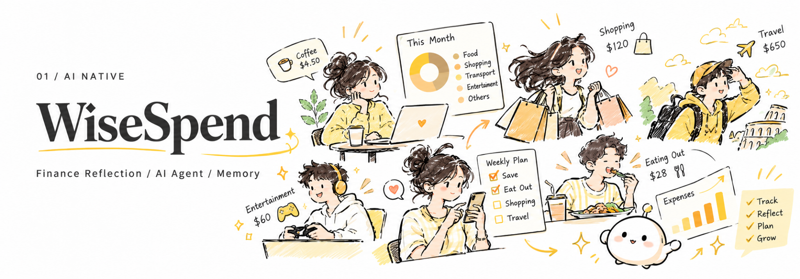
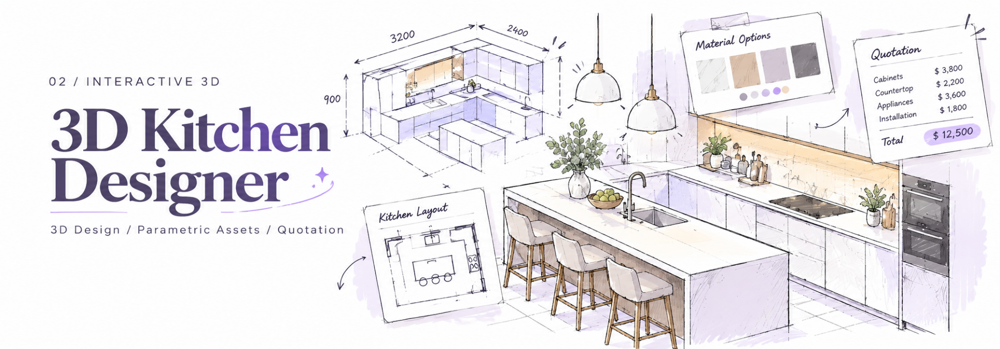
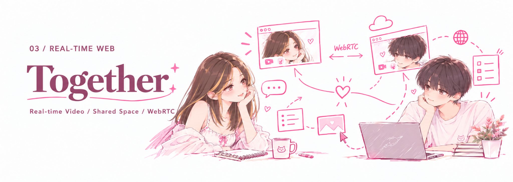
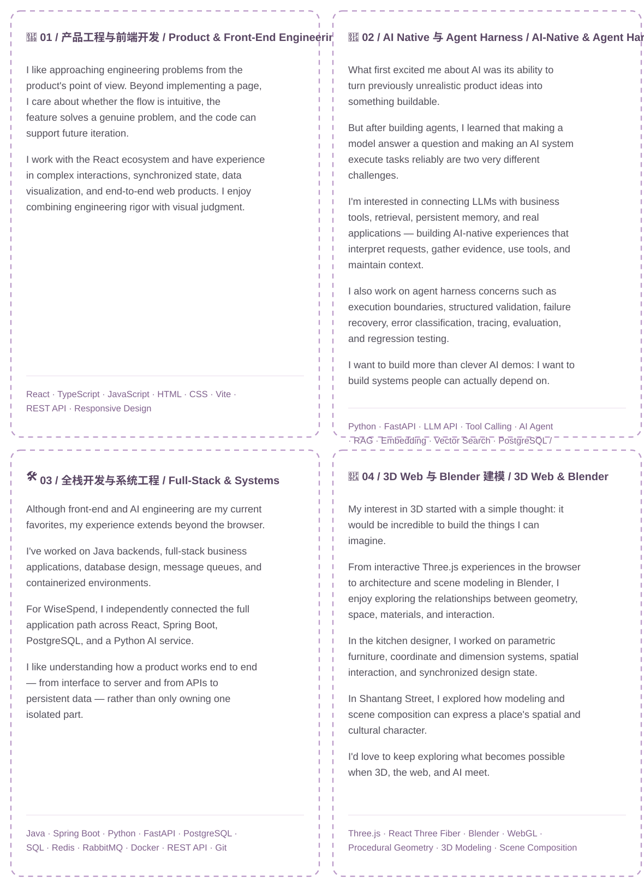

# Hi, it's Fiona! 💜

**AI × Product · Full-Stack · Agent · Creative Engineering**

**你好呀，这里是 Fiona！** 一个喜欢探索新技术、设计交互体验，也热衷于把脑洞变成真实产品的开发者。热爱生活，也热爱互联网。喜欢一切新鲜有趣、值得亲自动手尝试的东西。✨

**Hi, I'm Fiona!** I love exploring new technologies, designing interactive experiences, and turning the ideas in my head into real products. I'm equally excited about life and the internet, and I can never resist trying something new and interesting. ✨

`Full-Stack` · `AI Agent` · `3D Web` · `Creative Engineering`

[✨ 精选作品 / Selected Works](#selected-works) · [⚙️ 更多工程实践 / More Projects](#more-projects) · [🧠 技术方向 / Engineering](#-我的技术方向--engineering-focus)

---

## 🌷 关于我 / About Me

高强度互联网冲浪选手，长期关注新产品、AI 前沿动态和各种新奇的技术实验。24/7 在线和 AI 对话也不是没可能，Vibe Coding 重度玩家，偶尔觉得自己已经快和电脑融为一体了（但本人也是超级现充！）。

技术栈有点杂，因为真的什么都想试试。

看到各种不熟悉的技术，都觉得可以研究和尝试，以及能不能拿来实现脑子里那些奇怪又好玩的想法。比起只使用现成的工具，我更喜欢亲自动手，从原理摸索到实际应用。

尤其喜欢思考完整的产品体验：一个想法为什么值得做？用户真的需要什么？如何让复杂的技术变成简单、自然、甚至有一点惊喜的交互？

我对 AI 的兴趣也不止于模型本身，更关注它能在不同产业和真实业务场景中创造什么新可能。

**一些不太正经但很真实的个人标签：**

- ☀️ **ENTP 阳光善良版：** E 值高达 92%，**欢迎来找我面试（聊天）**！真的很喜欢和人交流想法。
- 🤖 **重度技术宅：** 遇到喜欢的项目可以每天深度沉浸在 Coding 里。AI 的兴起到底把 ADHD 调成了什么？
- 🚀 **创业脑袋：** 喜欢从产品和商业价值出发思考问题。IT 创业课程拿过 92 分，也确实很享受从零构思一个产品的过程。
- 🍸 **调酒艺术家：** 作品颇受好友好评，偶尔研究一下现实世界的配方与用户体验。
- 🎓 **悉尼大学 CS 硕士：** 成绩 Distinction，诶呀没 HD 因为第一学期还没爱上代码。
- 🎮 **Steam 游戏收藏家：** 游戏买得很认真，通关进度则是另一个故事。

**目前最感兴趣的方向：**

- 🎨 **产品与交互设计：** 喜欢精致、自然、有表现力的产品，也喜欢研究复杂业务背后的交互逻辑。
- 🧠 **AI Native 应用：** 探索大模型、工具调用、长期记忆与真实业务结合后，能够创造哪些新的产品体验。
- ⚙️ **Agent Harness 工程：** 不满足于让 Agent 看起来很聪明，更希望它能够可靠地执行任务、处理异常，并给出有依据的结果。
- 🪄 **创意与灵感：** 脑子里有超级超级多想法，最大的乐趣就是把其中一些真正做出来。

I'm an extremely online tech enthusiast who follows new products, frontier AI developments, and unconventional experiments. Chatting with AI around the clock? Entirely possible. I'm heavily into vibe coding, and sometimes feel like I'm merging with my computer (but I also have a very active social life!).

My tech stack is a little eclectic because I genuinely want to try everything.

When I encounter an unfamiliar technology, I immediately want to understand how it works, what I can build with it, and whether it could bring one of my strange, fun ideas to life. I enjoy going beyond ready-made tools, digging into the fundamentals, and building something myself.

I'm especially interested in the full product experience: Why is an idea worth building? What do users actually need? And how can complex engineering become a simple, intuitive, occasionally delightful interaction?

My curiosity about AI goes beyond models themselves. I want to see what AI can make possible in real industries and business workflows.

**A few slightly unserious but very real facts about me:**

- ☀️ **The friendly, sunny ENTP edition:** 92% extroverted. **I'd love to chat!** I genuinely enjoy exchanging ideas with people.
- 🤖 **Dedicated tech nerd:** I can spend entire days immersed in a project I love. Seriously, what has the AI revolution done to my ADHD?
- 🚀 **Startup brain:** I enjoy thinking in terms of products and business value. I scored 92 in an IT entrepreneurship course and love taking a product from zero to one.
- 🍸 **Amateur mixologist:** My cocktails have received very positive reviews from friends. Sometimes I experiment with recipes and user experience in the physical world.
- 🎓 **University of Sydney CS master's:** Graduated with a Distinction average. No High Distinction — I hadn't quite fallen in love with coding during my first semester.
- 🎮 **Steam game collector:** I'm excellent at buying games. Finishing them is a separate skill.

**What I'm most excited about:**

- 🎨 **Product & interaction design:** Thoughtful interfaces, polished experiences, and the logic underneath complex workflows.
- 🧠 **AI-native products:** New experiences made possible by combining LLMs, tools, persistent memory, and real business systems.
- ⚙️ **Agent harness engineering:** Making agents not only capable, but reliable, resilient to failures, and grounded in evidence.
- 🪄 **Creative experiments:** I have more ideas than I can count. Building some of them is the best part.

---

<strong>✨ 精选作品 / Selected Works</strong>　　点击展开  /  Click to explore

### 01 / 🪻 知省 WiseSpend

🔗 **[查看知省产品案例 / Explore the case study](https://github.com/fionaxuxyz/wisespend-case-study)**

**AI 驱动的个人财务复盘助手 / AI-powered personal finance reflection assistant**

#### 不只是记账，更是理解自己。

很多 P 人都经历过这样的时刻：某天突然决定认真理财，兴致勃勃下载记账软件，坚持记录每一笔消费，然后……就没有然后了。

即使真的坚持记账，面对一堆数字和统计图表，也未必知道下一步该做什么。钱到底花在哪里了？哪些消费真正带来了快乐？哪些习惯值得调整？

我想做一个不要求用户先成为理财高手，也不需要每天自律打卡的财务助手。于是有了 **知省 WiseSpend**。

它希望降低财务管理的门槛，让不爱做计划的人，也能轻松开始理解自己的消费行为。

知省不仅记录交易，还结合结构化财务分析、AI Agent、长期记忆和知识检索，让用户通过自然语言完成消费查询、预算分析与财务复盘。更重要的是，它能够结合历史交互理解用户的目标与偏好，让每一次对话不再从零开始。

希望它能让财务管理少一点压力，多一点自我发现。

**核心产品体验**

- 💬 **聊天就能查账：** 不需要研究复杂的筛选器，直接问 AI「上个月我是不是奶茶喝太多了？」。
- 🧠 **有上下文的长期记忆：** 记住用户的重要目标、习惯与偏好，让后续交流更加自然。
- 📊 **消费复盘：** 分析支出趋势、预算执行情况和消费模式，让数字背后的行为变得清晰。
- 📚 **知识辅助：** 结合 RAG 检索相关知识，为用户提供更有依据的解释与建议。

**工程亮点**

- 独立设计 React 前端、Spring Boot 业务后端、PostgreSQL 数据层与 Python AI Service 协作的完整应用架构。
- 基于 Tool Calling 构建可访问真实账本数据的 AI Agent，并通过结构化工具执行财务查询与分析。
- 结合长期记忆与 RAG，支持有上下文的个性化交互与知识辅助。
- 设计 Agent Harness，围绕证据校验、工具调用、异常处理、Tracing 与回归评测构建可靠性机制。
- 通过业务数据与 AI 推理分层，让模型负责理解和决策，让结构化数据与工具提供可验证的事实依据。

#### Don't just track your money. Understand yourself.

Many spontaneous, go-with-the-flow people know the pattern: one day you decide to take your finances seriously, enthusiastically download an expense tracker, log every purchase — and then quietly stop.

Even if you keep tracking, a wall of numbers and charts doesn't necessarily tell you what to do next. Where did the money go? Which purchases actually made you happy? Which habits are worth changing?

I wanted a finance companion that doesn't require you to become a budgeting expert or maintain a perfect daily routine. That's how **WiseSpend** began.

WiseSpend lowers the barrier to personal finance reflection, especially for people who don't naturally enjoy detailed planning.

Beyond recording transactions, it combines structured financial analysis, AI agents, long-term memory, and knowledge retrieval. Users can ask questions in natural language, review budgets, and explore spending patterns. By retaining relevant goals and preferences, the experience can continue across conversations instead of starting from scratch every time.

My hope is to make financial management a little less stressful and a little more about self-discovery.

**Product experience**

- 💬 **Ask your finances anything:** No complicated filters required. Just ask, “Did I spend too much on bubble tea last month?”
- 🧠 **Contextual long-term memory:** Retains important goals, habits, and preferences for more natural follow-up conversations.
- 📊 **Spending reflection:** Makes trends, budget progress, and behavioral patterns easier to understand.
- 📚 **Knowledge assistance:** Uses RAG to retrieve relevant context and support better-grounded explanations.

**Engineering highlights**

- Independently designed the application architecture connecting React, a Spring Boot business backend, PostgreSQL, and a Python AI service.
- Built a tool-calling AI agent that queries real ledger data through structured finance tools.
- Combined persistent memory and RAG for contextual interactions and knowledge-assisted responses.
- Designed an agent harness with evidence validation, tool execution controls, error handling, tracing, and regression evaluation.
- Separated business facts from model reasoning, keeping verifiable financial data in structured services rather than the LLM.

**Stack:** `React` · `Spring Boot` · `FastAPI` · `PostgreSQL` · `pgvector` · `OpenAI Agents SDK`

🔗 **[查看产品案例 / Explore the case study](https://github.com/fionaxuxyz/wisespend-case-study)**

*个人独立项目 / Independent project · 核心源代码未公开 / Source code private*

---

### 02 / 🏡 3D 厨房设计器 / 3D Kitchen Designer

**基于浏览器的交互式 3D 厨房设计与报价平台 / Browser-based interactive kitchen design and quotation platform**

#### 从空间想象，到真正看得见、改得动的设计方案。

装修时最让人头疼的事情之一，就是脑子里的设计想法和最终呈现的效果总有距离。平面图不够直观，三维效果难以自由调整，改完设计之后，报价又可能是另一回事。

这个项目希望把空间设计、3D 可视化和报价流程整合到同一个产品中，让用户能够直接在浏览器里规划厨房、调整家具布局和尺寸，并查看相应的报价信息。

在项目中，我担任 Team Leader 和核心前端开发者，主要负责 3D 产品链路的设计与实现，同时参与需求分析、团队协调和技术推进。

这也是我第一次在一个完整的业务项目中，深入处理从三维几何、坐标体系到交互状态与报价逻辑的一整套工程问题。

**核心产品体验**

- 🏠 **交互式 3D 设计：** 在浏览器中查看和编辑厨房空间，自由调整家具布局。
- 📐 **参数化家具：** 根据实际业务尺寸动态生成与调整 3D 家具资产，而不只是展示固定模型。
- 🔄 **2D / 3D 联动：** 平面编辑与三维场景保持数据一致，减少重复操作。
- 💰 **设计与报价同步：** 将设计参数与业务报价连接起来，让设计方案不仅好看，也能被计算。

**工程亮点**

- 作为团队负责人，推进核心 3D 产品链路的需求拆解、开发与交付。
- 基于 React Three Fiber 与 Three.js 构建浏览器端 3D 交互系统。
- 使用 Procedural Geometry 实现支持业务尺寸的参数化资产生成。
- 统一业务坐标、Three.js 世界坐标、局部坐标与尺寸换算逻辑。
- 实现 2D / 3D 设计状态同步与 Design-to-Quote 业务联动。
- 优化三维资源加载、渲染性能及交互体验。

#### From imagined spaces to designs you can see and change.

One of the hardest parts of renovating a kitchen is translating an idea into a practical result. Floor plans can feel abstract, 3D previews can be difficult to adjust, and quotations may not stay in sync when designs change.

This project brings space planning, interactive 3D visualization, and quotations together in the browser. Users can lay out a kitchen, resize and reposition furniture, and see how design decisions connect to pricing.

I worked as Team Leader and core front-end engineer, owning much of the 3D product workflow while coordinating requirements, delivery, and technical decisions.

It was also my first opportunity to solve an integrated set of production-style problems spanning geometry, coordinate systems, interaction state, and quotation logic.

**Product experience**

- 🏠 **Interactive 3D design:** Explore and edit kitchen spaces directly in a browser.
- 📐 **Parametric furniture:** Generate and resize furniture assets from real business dimensions instead of relying only on fixed models.
- 🔄 **2D/3D synchronization:** Keep floor-plan edits and 3D scene state consistent.
- 💰 **Design-to-quote:** Connect design parameters to calculable quotation data.

**Engineering highlights**

- Led requirements breakdown and delivery for the core 3D product workflow.
- Built browser-based 3D interactions with React Three Fiber and Three.js.
- Used procedural geometry to generate parametric assets driven by business dimensions.
- Unified business-space, world-space, local-space, and dimensional transformations.
- Connected 2D/3D state with quotation logic and improved asset loading and rendering performance.

**Stack:** `React` · `Three.js` · `React Three Fiber` · `Procedural Geometry`

*团队项目 / Team project · Team Leader & core 3D engineer · 商业项目源代码未公开 / Commercial source code private*

---

### 03 / 💞 Together · 双人实时互动空间 / Shared Space for Two

**基于 WebRTC 的双人实时视频与共享场景应用 / WebRTC-powered video and shared-scene app**

#### 让距离不再意味着缺席。

做这个项目的起因其实很简单：我真的每天都很想念远距离的男朋友。💗

普通视频通话当然能看到彼此，但我总觉得少了点什么。

如果两个人不只是分别待在屏幕的两个小窗口里，而是能够出现在同一间房间、同一个风景里，甚至像真的坐在一起一样，会不会更有趣？

我尝试过思考现有的视频应用能够提供哪些体验，却发现自己真正想要的东西其实很简单：足够流畅、足够自然，不需要下载复杂的软件，也不想为一堆用不上的附加功能付费。

尤其是实时人物抠图与场景融合，我希望它看起来尽可能自然，而不是简单地把两个视频画面生硬地拼在一起。

既然如此，不如自己做一个。

于是有了 **Together**。

它是我独立设计、开发并部署的一款双人实时互动 Web App，结合 WebRTC 音视频通信、人物画面处理与共享虚拟场景，让远距离的两个人能够拥有更有陪伴感的数字空间。

产品围绕双人使用场景设计，尽量减少不必要的功能，专注于轻量、自然和有趣的互动体验。

从本地开发到实际部署，我也完成了前后端的线上运行配置，使用阿里云与 Render 承载相关服务，让应用能够真正通过互联网使用，而不只是停留在本地 Demo。

它可能不是一个宏大的商业项目，但确实解决了我自己很想解决的问题。

**核心产品体验**

- 📹 **实时音视频：** 两个人通过浏览器即可进行实时视频交流，无须安装独立客户端。
- 🌷 **共享虚拟场景：** 将双方画面组合进同一个场景，创造更自然的陪伴体验。
- 🪄 **自由布局：** 支持不同的画面组合和场景模式，调整人物的位置、缩放和前后景关系。
- 📱 **响应式设计：** 兼顾桌面浏览器和手机端的布局与交互体验。
- 💗 **轻量化体验：** 聚焦真正需要的双人互动功能，减少复杂配置和无关操作。

**工程亮点**

- 基于 WebRTC 构建浏览器端实时音视频通信流程。
- 实现人物画面处理与共享场景组合，探索实时视频和创意前端交互的结合。
- 设计 Room-Level Shared State，将场景模式、背景与前景归属、参与者 Transform 和场景配置纳入统一状态模型。
- 实现双端状态同步，并将实时媒体传输与场景状态管理解耦。
- 适配不同屏幕尺寸，支持桌面端与移动端使用。
- 使用阿里云与 Render 完成线上部署和服务配置。

#### Distance shouldn't mean absence.

The reason I built this was pretty simple: I missed my long-distance boyfriend every day. 💗

Regular video calls let us see each other, of course. But I kept thinking: what if we weren't confined to separate rectangles on a screen? What if we could appear in the same room, in the same scene, almost as though we were sitting together?

I didn't want complicated software, unnecessary features, or another subscription just to create that feeling. I wanted something lightweight, smooth, and natural — especially when compositing people into a shared background.

So I decided to build it.

**Together** is an independently designed, built, and deployed web app combining WebRTC video, person-video processing, and synchronized virtual scenes. It's a focused product for two people who want a more shared sense of presence.

I also took it beyond a local demo, configuring cloud deployment using Alibaba Cloud and Render so it could be used over the internet.

It may not be a huge commercial platform, but it solves a problem that genuinely mattered to me.

**Product experience**

- 📹 **Live audio and video:** Two people can connect directly through their browsers.
- 🌷 **Shared virtual scenes:** Compose both participants into the same digital environment.
- 🪄 **Flexible layouts:** Adjust scene modes, participant positions, scales, and foreground/background relationships.
- 📱 **Responsive design:** Adapt the experience for both desktop and mobile browsers.
- 💗 **Lightweight by design:** Prioritize the essential shared-space experience over feature bloat.

**Engineering highlights**

- Built browser-based real-time audio/video communication using WebRTC.
- Combined processed participant video with interactive scene composition.
- Designed a room-level shared state containing scene mode, foreground/background ownership, transforms, and scene configuration.
- Synchronized layouts across clients while keeping media transport separate from scene-state logic.
- Adapted the interface for desktop and mobile and deployed services through Alibaba Cloud and Render.

**Stack:** `React` · `TypeScript` · `WebRTC` · `Real-Time State Synchronization` · `Responsive Design`

*个人独立项目 / Independent project · 已部署 / Deployed · 源代码未公开 / Source code private*

---

### 04 / 🌸 山塘街多媒体交互体验 / Shantang Street

🔗 **[查看山塘街作品 / Explore Shantang Street](https://fionaxuxyz.github.io/shantang-street-portfolio/)**

**以苏州山塘街为主题的交互式数字文化展示作品 / 3D cultural heritage and interactive web showcase**

#### 用 3D 建模与数字交互，重新讲述城市文化。

说起来，这个项目最开始只是一门课程的 Assignment。

课程本身并不是我最喜欢的部分，但看其他同学展示作品时，我反而很受触动。大家选了各种有趣的主题，认真建模、设计场景、展示自己的想法。

原来同一道作业题，也可以被做成这么多完全不同的世界。

我选择了苏州山塘街。

比起单纯制作一个展示网页，我更想亲自动手把传统街巷的建筑、空间和氛围重新构建出来。从建筑外形、比例关系到模型资产与场景构图，我希望能通过 3D 建模，把那些具有江南特色的空间元素转化为可以在数字世界中呈现的作品。

我很喜欢这种创作过程：先观察现实中的建筑，再研究如何用几何、材质与空间关系把它们重新表达出来。编程之外，数字建模本身也是一种很有趣的创造方式。

**项目亮点**

- 🏮 **传统建筑建模：** 围绕山塘街的建筑语言与空间特征制作数字场景资产。
- 🧊 **3D 场景构建：** 关注模型比例、空间布局、材质与整体视觉表现。
- 🎨 **文化与视觉表达：** 将江南街巷的地域特色融入数字作品。
- 🌐 **Web 作品展示：** 将建模成果与网页呈现结合，制作可在线浏览的项目作品集。

#### Retelling cultural stories through 3D modeling and the web.

This project started as a university assignment.

The course itself wasn't my favorite, but seeing classmates present their work genuinely moved me. Everyone chose different themes, built scenes, and expressed their ideas with care. It was amazing how one assignment could produce so many different worlds.

I chose Shantang Street in Suzhou.

Rather than build a conventional information page, I wanted to recreate some of the architecture, spatial character, and atmosphere of a traditional Jiangnan streetscape. I explored how architectural shapes, proportions, assets, materials, and scene composition could translate a real place into a digital one.

I loved the process: observing physical buildings, then thinking through how geometry and spatial relationships could express them. Modeling became another form of making things, beyond coding.

**Project highlights**

- 🏮 **Traditional architecture modeling:** Created digital assets inspired by Shantang Street's architectural character.
- 🧊 **3D scene building:** Explored proportions, layout, materials, and visual composition.
- 🎨 **Cultural storytelling:** Translated Jiangnan's visual identity into a digital medium.
- 🌐 **Web showcase:** Presented the modeling work in an accessible online portfolio.

**Stack / Tools:** `Blender` · `3D Modeling` · `Scene Composition` · `Web Presentation`

🔗 **[查看山塘街作品 / Explore the Shantang portfolio](https://fionaxuxyz.github.io/shantang-street-portfolio/)**

*个人课程作品 / Individual coursework · 已部署展示版 / Deployed showcase*

---

<strong>⚙️ 更多工程实践 / More Engineering Projects</strong>　　点击展开  /  Click to explore

### 📊 个人财务管理系统 / Budget Tracker

在这个团队项目中，我们围绕日常财务管理需求开发了一套 Web 应用，覆盖账户管理、交易记录、财务报表和数据分析等功能。

它是我参与完整前后端协作的一次实践，也让我更系统地接触了业务数据管理、API 交互和前端可视化。

**工程实践：** 参与账户、交易与报表模块开发；使用 React 构建可视化页面；通过 Spring Boot API 处理业务数据；支持报表分析与导出。

In this team project, we developed a personal finance web application covering account management, transactions, reports, and analytics.

It gave me practical experience collaborating across the front-end and back-end, working with business data, integrating APIs, and building financial visualizations.

**Engineering:** Contributed to account, transaction, and reporting workflows; built React data views; integrated Spring Boot APIs; supported analysis and report export.

**Stack:** `React` · `Spring Boot` · `PostgreSQL` · 团队项目 / Team project

### 📦 企业电商系统 / Enterprise Online Store

一个围绕真实电商业务流程构建的后端工程项目。订单完成之后，还涉及配送请求、状态更新、消息通知等一系列异步操作。

我们使用 Spring Boot、RabbitMQ 和 PostgreSQL 构建相关流程，探索如何通过消息机制让不同业务模块协作，而不是将所有操作紧密耦合在一起。

**工程实践：** RabbitMQ 异步消息、Spring Boot 服务与接口、PostgreSQL 数据存储、Docker 环境管理，以及事件驱动的模块解耦。

A back-end engineering project built around realistic e-commerce workflows. After placing an order, delivery requests, status updates, and notifications need to be coordinated asynchronously.

We used Spring Boot, RabbitMQ, and PostgreSQL to explore how message-driven workflows can connect services without tightly coupling every operation.

**Engineering:** Asynchronous RabbitMQ messaging, Spring Boot services, PostgreSQL persistence, Docker-managed infrastructure, and event-driven decoupling.

**Stack:** `Java` · `Spring Boot` · `RabbitMQ` · `PostgreSQL` · `Docker`

🔗 [查看代码 / View repository](https://github.com/fionaxuxyz/Enterprise-Online-Store-)

### 🎮 Quiz Game · 互动答题小游戏 / Interactive Quiz

Quiz Game 是一个围绕答题互动开发的 Web 项目，重点练习前端交互逻辑、用户操作反馈和应用状态管理。

做小游戏很有意思的一点是：功能本身可能并不复杂，但想让每次点击、切换和反馈都顺畅自然，依然需要认真设计。

**工程实践：** JavaScript 答题流程、状态更新、用户反馈、HTML/CSS 页面结构与交互细节。

Quiz Game is a browser-based interactive quiz built to practice front-end interaction logic, feedback, and application state management.

Even when the basic mechanics are simple, making each click, transition, and response feel natural takes careful thought.

**Engineering:** JavaScript quiz flows, state updates, user feedback, HTML/CSS page structure, and interaction details.

**Stack:** `JavaScript` · `HTML` · `CSS`

🔗 [查看代码 / View repository](https://github.com/fionaxuxyz/Quiz-Game-)

---

## 💻 我的技术方向 / Engineering Focus

---

## 🎓 教育背景 / Education

**悉尼大学 / University of Sydney** — 计算机科学硕士 / Master of Computer Science

**华南理工大学 / South China University of Technology** — 数学与应用数学学士 / Bachelor of Mathematics and Applied Mathematics

---

## 💌 联系我 / Contact

如果你也喜欢 AI、产品、交互体验，或者脑子里有各种奇怪但有趣的想法，欢迎来找我聊天、交流项目或合作！

If you're into AI, products, interactive experiences, or unusual ideas worth building, I'd love to chat, exchange ideas, or collaborate.

💻 **GitHub:** [fionaxuxyz](https://github.com/fionaxuxyz)

✉️ **Email:** [fionaxuyuzu@outlook.com](mailto:fionaxuyuzu@outlook.com)

---

**谢谢你来到我的数字小角落！🌷**

这里有认真打磨的产品，也有一时兴起的脑洞；有复杂的工程问题，也有一些纯粹因为觉得好玩而开始的实验。希望以后能继续把更多想法变成现实。

**Thanks for visiting my little corner of the internet! 🌷**

You'll find carefully built products, spontaneous experiments, difficult engineering problems, and things I made simply because they seemed fun. I hope to keep bringing more ideas to life.

*Built with curiosity, imagination, and way too many ideas. ✨*

